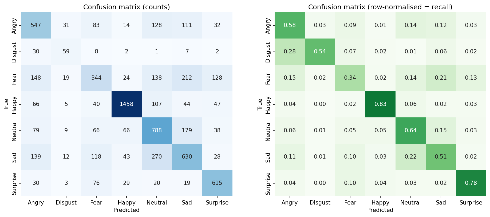
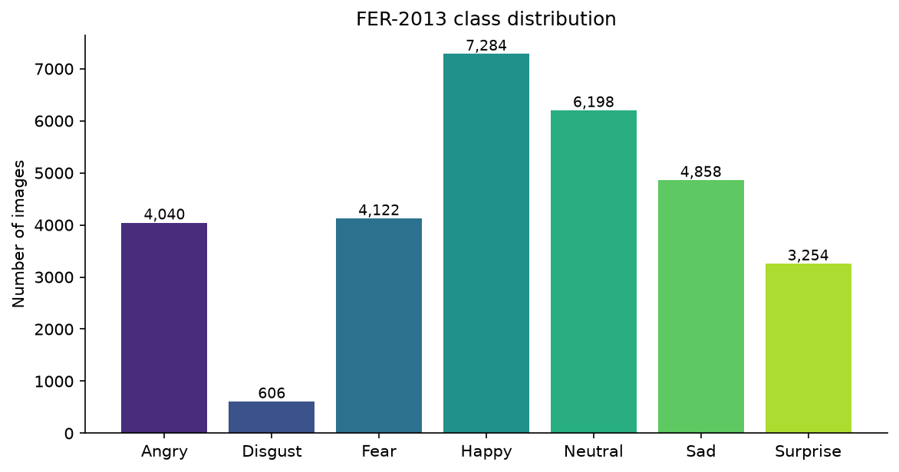

# AI-Based Facial Expression Recognition (CNN · TensorFlow · OpenCV · Streamlit)


An end-to-end deep learning application that detects human faces and classifies them into **seven visual expression categories** — **Angry, Disgust, Fear, Happy, Neutral, Sad, and Surprise** — from uploaded images or a live webcam feed using a custom Convolutional Neural Network (CNN) trained on the **FER-2013** dataset.

---

## Table of Contents
- [Model Performance & Results](#model-performance--results)
- [Dataset Summary](#dataset-summary)
- [How It Works](#how-it-works)
- [Project Structure](#project-structure)
- [Installation & Setup](#installation--setup)
- [Running the Application](#running-the-application)
- [Training & Evaluation (Optional)](#training--evaluation-optional)
- [Testing](#testing)
- [Privacy & Responsible Use](#privacy--responsible-use)
- [Known Limitations](#known-limitations)

---

## Model Performance & Results

The trained model (`models/emotion_model.keras`) was evaluated on a leakage-free held-out test set of **7,092 images**[cite: 2, 5].

### Overall Metrics
| Metric | Score |
| :--- | :---: |
| **Test Accuracy** | **61.93%**[cite: 2, 5] |
| **Test Loss** | `1.0185`[cite: 2, 5] |
| **Macro Average (Precision / Recall / F1)** | `0.6053` / `0.5925` / `0.5975`[cite: 2, 5] |
| **Weighted Average (Precision / Recall / F1)** | `0.6229` / `0.6193` / `0.6198`[cite: 2, 5] |

### Per-Class Classification Report
| Emotion | Precision | Recall | F1-Score | Test Support |
| :--- | :---: | :---: | :---: | :---: |
| **Angry** | 0.5387[cite: 2, 5] | 0.5518[cite: 2, 5] | 0.5452[cite: 2, 5] | 946[cite: 2, 5] |
| **Disgust** | 0.6042[cite: 2, 5] | 0.5321[cite: 2, 5] | 0.5659[cite: 2, 5] | 109[cite: 2, 5] |
| **Fear** | 0.4733[cite: 2, 5] | 0.3939[cite: 2, 5] | 0.4300[cite: 2, 5] | 1,013[cite: 2, 5] |
| **Happy** | **0.8605**[cite: 2, 5] | **0.8240**[cite: 2, 5] | **0.8419**[cite: 2, 5] | 1,767[cite: 2, 5] |
| **Neutral** | 0.5212[cite: 2, 5] | 0.6024[cite: 2, 5] | 0.5589[cite: 2, 5] | 1,225[cite: 2, 5] |
| **Sad** | 0.4954[cite: 2, 5] | 0.5234[cite: 2, 5] | 0.5090[cite: 2, 5] | 1,240[cite: 2, 5] |
| **Surprise** | **0.7441**[cite: 2, 5] | **0.7197**[cite: 2, 5] | **0.7317**[cite: 2, 5] | 792[cite: 2, 5] |

### Evaluation Visuals
<p align="center">
  
</p>

- **Strongest Categories:** **Happy** (`0.84` F1) and **Surprise** (`0.73` F1) show high precision and recall[cite: 2, 5].
- **Common Confusions:** Visually subtle negative expressions show expected overlap — **Sad** is occasionally predicted as **Neutral** (277 samples), and **Fear** shares overlap with **Sad** (215 samples) and **Angry** (134 samples)[cite: 3, 5].

---

## Dataset Summary

The dataset consists of **57,683** grayscale facial images (`48×48` pixels) across 7 expression classes[cite: 1, 4]:

| Class | Train Split | Test Split (Raw) | Total Images |
| :--- | :---: | :---: | :---: |
| **Angry** | 7,215[cite: 4] | 958[cite: 4] | 8,173[cite: 1, 4] |
| **Disgust** | 7,215[cite: 4] | 111[cite: 4] | 7,326[cite: 1, 4] |
| **Fear** | 7,215[cite: 4] | 1,024[cite: 4] | 8,239[cite: 1, 4] |
| **Happy** | 7,215[cite: 4] | 1,774[cite: 4] | 8,989[cite: 1, 4] |
| **Neutral** | 7,215[cite: 4] | 1,233[cite: 4] | 8,448[cite: 1, 4] |
| **Sad** | 7,215[cite: 4] | 1,247[cite: 4] | 8,462[cite: 1, 4] |
| **Surprise** | 7,215[cite: 4] | 831[cite: 4] | 8,046[cite: 1, 4] |
| **Total** | **50,505** | **7,178** | **57,683**[cite: 4] |

- **Data Integrity:** `0` corrupt/unreadable files detected[cite: 4].
- **Leakage Prevention:** **2,748 exact duplicate images** were identified via image hashing and deduplicated across splits (priority: `test > validation > train`), yielding **7,092** unique test images[cite: 2, 4, 5].

<p align="center">
  
</p>

---

## How It Works

1. **Leakage-Safe Data Pipeline (`src/data_loader.py`):** Every image is hashed before splitting so no duplicate image ever appears in both training and evaluation sets. Validation data is created via a stratified split from the training pool.
2. **CNN Architecture (`src/model.py`):**
   - **Input:** `48×48×1` normalized grayscale face crop (`[0, 1]`).
   - **Data Augmentation (training only):** Random horizontal flip, rotation, zoom, and translation.
   - **Feature Extractor:** 4 convolutional blocks (`32 → 64 → 128 → 256` filters), each containing `2 × [Conv2D(3×3) → BatchNorm → ReLU] + MaxPooling2D + Dropout` with L2 regularization.
   - **Classifier Head:** `GlobalAveragePooling2D → Dense(256) → BatchNorm → ReLU → Dropout(0.5) → Dense(7, softmax)`.
3. **Real-Time Inference (`src/face_detection.py` & `src/predict.py`):**
   - Detects faces using OpenCV Haar Cascades → crops & converts to `48×48` grayscale → runs CNN inference → outputs class probabilities in alphabetical order (`angry`, `disgust`, `fear`, `happy`, `neutral`, `sad`, `surprise`).

---

## Project Structure

```text
├── app.py                     # Multi-page Streamlit web dashboard
├── requirements.txt           # Project dependencies
├── pytest.ini                 # Pytest configuration
├── README.md
├── assets/
│   └── project_logo.png
├── dataset/
│   └── README.md              # Instructions for placing FER-2013 data
├── models/
│   └── emotion_model.keras    # Trained Keras model
├── results/                   # Evaluation outputs & plots
│   ├── metrics.json
│   ├── classification_report.txt
│   ├── confusion_matrix.png
│   ├── class_distribution.png
│   ├── sample_images.jpg
│   ├── training_history.png
│   └── training_config.json
├── src/
│   ├── config.py              # Paths, class labels, constants
│   ├── data_loader.py         # Dataset validation, deduplication, splitting
│   ├── preprocessing.py       # Normalization & 48x48x1 preprocessing
│   ├── visualization.py       # Plotting utilities
│   ├── model.py               # CNN architecture definition
│   ├── train.py               # Training CLI with callbacks & class weights
│   ├── evaluate.py            # Test-set evaluation CLI
│   ├── face_detection.py      # OpenCV Haar-cascade face detector
│   └── predict.py             # Inference engine, bounding-box overlays, webcam loop
├── notebooks/
│   ├── data_exploration.ipynb
│   └── model_training.ipynb
└── tests/
    ├── test_data_loader.py
    ├── test_preprocessing.py
    └── test_prediction.py